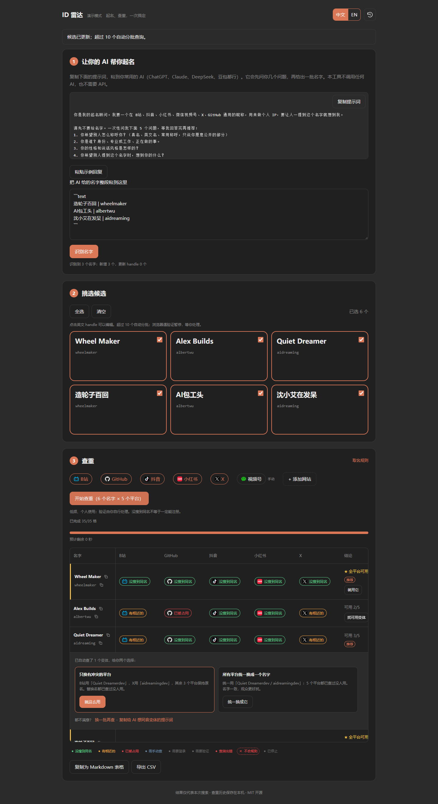

# ID 雷达 · ID Radar

**起名、查重，一次搞定。** 让你自己的 AI 帮你起名，再一键查 B站、抖音、小红书、GitHub、X 等平台有没有人用过同名。
**Find a name, check it everywhere.** Let your own AI suggest names, then check whether they're already taken on Bilibili, Douyin, Xiaohongshu, GitHub, X and more.

「用 Claude 开发的 100 个开源工具」第 001 号 · Tool #001 of *100 open-source tools built with Claude*

[中文](#中文) · [English](#english) · [作者主页 / Find me](#作者主页--find-me)

---

## 中文

### 它能做什么

- **起名**：复制一段提示词给你常用的 AI（ChatGPT、Claude、DeepSeek、豆包都行），它会先问你几个问题再给一批名字。**本工具不调用任何 AI，也不需要 API 密钥。**
- **识别**：把 AI 的回复整段粘回来，自动认出“名字 | 英文 handle”。
- **查重**：一次查 B站、GitHub、X、抖音、小红书；视频号给出手动查法；还能自己添加网站。
- **推荐**：按可用平台数排序，前三名有冲突的自动找变体，给出“只换冲突平台”和“全平台统一”两种方案。
- **复制**：名字和 handle 旁有复制图标；全平台可用时点“就用它”直接复制名字。

### 怎么启动

1. 安装 [Python 3.11+](https://www.python.org/downloads/)（Windows 安装时勾选 “Add Python to PATH”），电脑上要有 Microsoft Edge 或 Google Chrome。
2. 下载本仓库（绿色 **Code → Download ZIP**，解压）。
3. Windows **双击 `start.bat`**；macOS / Linux 在仓库目录运行 `bash start.sh`。
4. 第一次会自动装依赖（需要联网），然后浏览器自动打开 <http://127.0.0.1:8765>。关掉黑色命令行窗口即退出。

想先看看效果、不联网：`start.bat --demo`（或 `bash start.sh --demo`），再打开 <http://127.0.0.1:8765>。

### 怎么用

1. **第 1 步**：点“复制提示词”，粘给你的 AI，回答它的问题，拿到一批名字。
2. 把 AI 的回复**整段**粘回第 1 步，点“识别名字”。
3. **第 2 步**：勾选想查的名字（一次最多 10 个，多了自动分批），英文 handle 可以点开改。
4. **第 3 步**：选平台，点“开始查重”。查到一半可以点“停止查重”。
5. 看结果：绿色“没搜到同名”、橙色“有相近的”、红色“已被占用”。有冲突的行会给变体方案；满意就复制名字去注册。

**抖音、小红书要先登录。** 页面顶部会提示，点“扫码登录”，用手机 App 扫屏幕上的二维码即可，登录一次会记住。
**遇到验证（抖音滑块、小红书“扫码验证身份”）**：工具会自动弹出那个窗口并在顶部闪烁提示，你自己完成验证后它会自动接着查。工具不会替你过验证码。

> **注意账号风险：** 抖音、小红书是用你的登录状态自动搜索，平台可能判定为“使用第三方工具模拟浏览”，对账号限流或限制功能。**建议用不常用的小号扫码登录，不要用你做内容的主号。**小号也可能被处理，请自行权衡；不想冒险的话，在第 3 步取消勾选抖音、小红书，自己去 App 里搜。

### 注意

- **没搜到同名 ≠ 一定能注册**，最终以平台注册时的提示为准。
- 所有数据只在你自己电脑上：历史在 `~/.idradar/`，不上传、不收集。
- 请低频、个人使用；工具有查询间隔，不做批量扫号。

完整说明（平台细节、自定义网站、本机接口、开发测试）见 [docs/GUIDE.zh-CN.md](docs/GUIDE.zh-CN.md)。

---

## English

### What it does

- **Name**: copy a prompt into the AI you already use (ChatGPT, Claude, DeepSeek…). It asks a few questions, then suggests names. **This tool never calls any AI and needs no API key.**
- **Parse**: paste the whole reply back; `name | handle` lines are recognized automatically.
- **Check**: Bilibili, GitHub, X, Douyin and Xiaohongshu in one go; WeChat Channels gets manual instructions; you can add your own websites.
- **Recommend**: rows are ranked by availability; the top three with conflicts get automatic variants, offered as "change only conflicting platforms" or "one name everywhere".
- **Copy**: copy icons next to every name and handle; **Use this name** copies a fully available name.

English mode shows GitHub, X and your custom websites by default; Chinese platforms can be restored anytime.

### Start

1. Install [Python 3.11+](https://www.python.org/downloads/) (on Windows tick "Add Python to PATH"). Microsoft Edge or Google Chrome must be installed.
2. Download this repository (**Code → Download ZIP**) and unzip it.
3. On Windows **double-click `start.bat`**; on macOS / Linux run `bash start.sh` in the folder.
4. The first run installs dependencies (internet needed), then opens <http://127.0.0.1:8765>. Close the terminal window to quit.

Offline demo: `start.bat --demo` (or `bash start.sh --demo`), then open <http://127.0.0.1:8765>.

### Use

1. **Step 1**: copy the prompt to your AI, answer its questions, get a batch of names.
2. Paste the **whole** reply back and click **Recognize names**.
3. **Step 2**: pick up to 10 names per batch (more run in batches); click a handle to edit it.
4. **Step 3**: choose platforms and click **Check N names on N platforms**. **Stop checks** is available at any time.
5. Read the results: green "No match found", amber "Similar name", red "Taken". Conflicting rows get variant plans; copy the name you like and register.

Douyin and Xiaohongshu require signing in once with a QR code shown on the page. When a platform asks for verification, its window pops up and a banner flashes; finish it yourself and checks continue automatically. The tool never solves verification for you.

> **Account risk:** Douyin and Xiaohongshu are searched automatically with your signed-in session. The platforms may treat this as "simulated browsing with third-party tools" and limit the account's reach or features. **Sign in with a spare account, not the main account you post from.** A spare account can still be restricted, so decide for yourself; to avoid the risk entirely, untick Douyin and Xiaohongshu in Step 3 and search in their apps yourself.

### Notes

- **"No match found" does not guarantee you can register the name.** The platform has the final say.
- Everything stays on your computer (`~/.idradar/`). No telemetry, no uploads.
- For occasional personal use only; requests are spaced out and bulk scanning is not supported.

Full guide (platform details, custom websites, local API, development): [docs/GUIDE.md](docs/GUIDE.md).

---

## 作者主页 / Find me

吴嘉鑫Jackson（Jackson Wu）· 挑战用 Claude 做 100 个开源工具，每期解决一个真实痛点。
Building 100 open-source tools with Claude, one real problem per episode.

| 平台 / Platform | 主页 / Profile |
| --- | --- |
|  B站 Bilibili | [space.bilibili.com/325412522](https://space.bilibili.com/325412522) |
|  抖音 Douyin | [吴嘉鑫Jackson](https://www.douyin.com/user/MS4wLjABAAAAt3s9iqgSNO-C8QfRNhMFw23MGEpHyYPqFi-qDodmJOl9Qjtms-mkf9hc6kxKRtIP) |
|  小红书 Xiaohongshu | [吴嘉鑫Jackson](https://www.xiaohongshu.com/user/profile/601a80ae00000000010013fb) |
|  视频号 WeChat Channels | 微信搜索「吴嘉鑫Jackson」 / search "吴嘉鑫Jackson" in WeChat |
|  YouTube | [@JacksonWJXX](https://www.youtube.com/@JacksonWJXX) |
|  X | [@JacksonWJXX](https://x.com/JacksonWJXX) |
| <picture><source media="(prefers-color-scheme: dark)" srcset="docs/images/icons/github-dark.png"></picture> GitHub | [JacksonWJXX](https://github.com/JacksonWJXX) |

## 许可 / License

[MIT](LICENSE)
