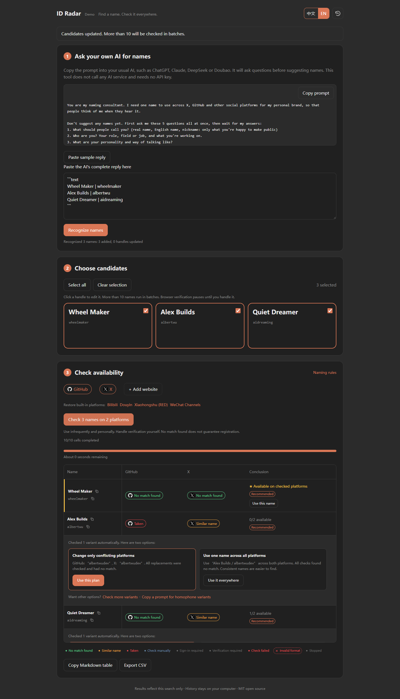

[中文说明](GUIDE.zh-CN.md) · [Back to README](../README.md)

# ID Radar

Recognize a list of names locally, check them across social platforms, and choose a practical name and handle plan.

**This tool does not call any AI service and does not need an API key.** Use your own AI for naming, then paste its reply here.



## Install and start

Install **Python 3.11+** from [python.org](https://www.python.org/downloads/) first. On Windows, enable “Add Python to PATH”. For real browser-based checks, install Microsoft Edge or Google Chrome. The tool uses your installed browser; do not run `playwright install`.

1. Download the repository and **double-click `start.bat` on Windows**.
2. On macOS / Linux, run `bash start.sh` from the repository directory.
3. The first launch creates `.venv` and installs `requirements.txt`; later launches reuse it. Installation needs an internet connection. Errors remain visible in the Windows console.

The normal launch opens <http://127.0.0.1:8765> after the server is ready. Only the local computer can access it. If the page does not open, visit that address yourself. Press `Ctrl+C` in the terminal to stop the tool. Close a previous instance if port 8765 is occupied.

Manual installation is also available:

```powershell
python -m venv .venv
.venv\Scripts\python -m pip install -r requirements.txt
.venv\Scripts\python -m idradar
```

On macOS / Linux, use `python3 -m venv .venv`, then `.venv/bin/python` for the other two commands. Running the tool needs **no Node.js, npm or frontend build**.

## Quick start

1. Copy the prompt in step 1 into your usual AI, such as ChatGPT, Claude, DeepSeek or Doubao.
2. Answer its five questions to get name suggestions.
3. Paste the entire reply back into step 1 and click **Recognize names**. You can also write one name per line.
4. Check the candidates and editable handles in step 2. Only the first 10 are selected automatically, including previously selected items. Existing names receive updated nonempty handles.
5. Choose platforms and start checking. More than 10 names run in batches of at most 10. Browser verification pauses that platform until you handle it; HTTP rate limiting still stops further requests.
6. Conflicting rows automatically show two recommendations. Adopt one, and **My ID plan** provides final names, copy buttons and registration / rename links. For an original name with no conflicts, **Use this name** simply copies it. The copy icons next to each name and handle in the results table copy them too.

Recommended reply format:

```text
Alex Builds | alexbuilds
Quiet Dreamer | quietdream
```

Code blocks, ordinary/full-width pipes, numbering, bullets and quotes are supported. Explanation lines are discarded; when pipe-formatted lines exist, other lines must be bare names. Names are normalized and deduplicated. Up to 30 names are recognized per paste, and the candidate list supports up to 300. Review the recognized list before checking it.

Handles requested by the prompt use lowercase letters and digits, 5–15 characters. Missing handles get a pinyin fallback only if it fits within 15 characters; otherwise they remain empty. GitHub and X reject an empty handle without sending a request. **Copy handle prompt** helps you get replacements from your own AI; paste the reply back to update existing candidates.

## Languages and platforms

The visible **中文 | EN** switch changes the page immediately without clearing candidates, selections, results or adopted plans. The initial language follows the browser; a choice is saved locally. English initially shows GitHub, X and custom websites. Chinese initially shows all built-in platforms. Other platforms can be restored at any time.

| Platform | Method | What the result means |
| --- | --- | --- |
| Bilibili | Browser user search, no login required | Exact and similar names from the current page. Loosely related results alone count as no match; up to three are listed for reference. |
| GitHub | HTTP, no login | Handle only: 404 means no account found, 200 means taken. Reserved names may still be unavailable for registration. |
| X | HTTP to `x.com/<handle>`, no login | Handle only: 404 means no profile, 200 means taken, including accounts that retain a name after suspension or deactivation. Display names are not checked. |
| Douyin | Sign in yourself in the dedicated browser | Uses web search, session cookies and selectors that may need maintenance after site changes. |
| Xiaohongshu (RED) | Sign in yourself in the dedicated browser | Same limitations. Nickname uniqueness is not officially confirmed by the collected evidence; follow the platform's instructions. |
| WeChat Channels | Manual only | In WeChat, open Discover → Channels → Search, or try the name when creating / renaming a channel. The tool does not automate WeChat. |

**No match found does not guarantee that a name can be registered.** Manual, sign-in, failed and invalid cells do not count as conflicts or as confirmed availability. The original row's availability summary covers automatic platforms; a unified variant requires an available result on every selected platform, so a manual platform prevents automatic confirmation of that option.

## The dedicated browser

Bilibili, Douyin and Xiaohongshu share one persistent, headed browser at `~/.idradar/browser-profile`. It starts offscreen and reuses one fixed tab per platform. Normal checks do not bring it to the front. Closing the window is safe; the next query or login reopens it. Sign-in status refreshes every two seconds; an undetermined status is shown as **Unconfirmed**. Xiaohongshu uses its signed-in sidebar profile link, never its guest `web_session` cookie; Douyin may use login-only session cookies. The first sign-in-required result short-circuits later checks for that platform; if you sign in with QR during a check, later cells are checked normally.

Click **QR sign-in** to display the QR image already shown on the platform page. The tool waits for the tested image selectors (`img.qrcode-img` on Xiaohongshu and `img[aria-label="二维码"]` on Douyin) to finish loading, then reads the displayed data URL or captures that image. The image stays in memory, with a 120-second countdown, refresh on expiry, and a mobile screenshot-to-album hint. Confirmed sign-in closes the card after 1.5 seconds. A missing QR code saves local snapshots and brings the window onscreen. Finish signing in yourself, then click **I've signed in — continue** to hide it again; **Open sign-in window** can bring it back.

When a browser platform needs verification (for example a Douyin slider or Xiaohongshu's scan-to-verify-identity page), its window opens automatically and a flashing banner appears at the top, while other platforms can continue. Complete verification yourself. The tool checks the existing verification markers once per second; after they disappear and remain absent for another second, it hides the window and retries the paused cell. **I've verified — continue checks** remains available as a backup. Only one verification window is shown at a time; platforms queue behind it. There is no automated solving, fingerprint masking or stealth browser code. Do not start a new sign-in on that platform while its verification card is active.

During a run, **Stop checks** aborts the stream and cancels remaining checks and variants. Completed cells stay; unfinished cells say **Stopped**, and history records `stopped: true`. Any active verification window returns offscreen. Start again to recheck the whole selection. A banner at the top reminds you when selected Douyin or Xiaohongshu accounts are not confirmed signed in, with QR sign-in buttons and **Skip for now**. It pulses three times unless reduced motion is enabled; starting checks shows the reminder again.

Why not use your everyday browser? The program can control only a window it opens itself. Reading login data from your regular browser would create security risks, so it does not do that. Sign in once in the dedicated window and the session is remembered.

Failed or unrecognized browser pages are saved, where possible, as HTML and full-page PNG files under `probe/`. Cell details show complete paths. **These files may contain account information.** They stay on your computer and are not uploaded. Share them with a developer only if you choose to; a closed page may prevent a complete capture.

## Custom websites and removing platforms

Click **+ Add website**, enter a 1–12 character label and an HTTP(S) URL containing `{name}` or `{handle}`. Substitutions are URL-encoded. You can add up to 10 sites.

- **Profile URL:** HTTP GET, redirects followed, 10-second timeout. Only 404 means no match; 200 means taken. Other HTTP codes need a manual check. Connection failures show a check error and proxy hint. A site may return 200 for a login or error page, so open it to confirm.
- **Search page:** no request is sent. The cell opens the substituted search URL in a new tab for you to inspect.

Custom sites have unknown naming rules. They are stored in ignored `custom_platforms.json`; new sites are selected automatically. Their “×” button asks for confirmation before deleting the record.

Every removal uses an in-page confirmation card. The “×” is an inline SVG, independent of installed fonts. Confirming a built-in removal hides it; **Restore built-in platforms** adds it back. Confirming a custom removal deletes its saved settings. At least one platform remains visible. Hidden lists are stored separately in `idradar.hidden.zh` and `idradar.hidden.en`; language uses `idradar.lang`. Storage failures do not prevent use during the current page session. Existing matrices retain their original platform configuration. Platform pills and result badges include platform icons, and the matrix has a vertically scrollable area with sticky column headers.

## Naming rules and automatic variants

**Naming rules** shows limits, character categories, uniqueness, rename restrictions and source confidence. Data comes from [the local research](platform_naming_rules.md), dated 2026-10-26. Sources can be conflicting or incomplete. **Always follow the platform's current registration instructions.** Only definite format violations block requests; unknown or conflicting rules produce warnings. For example, WeChat Channels counts one Chinese character as two units; X warns about conflicting length evidence only at four characters and rejects lengths above 15.

All original names, including later batches, are checked before variants. Rows rank by more available platforms, then fewer taken platforms, then original order. Only the best three rows receive a **Recommended** badge, and only conflicts among those three trigger automatic variants. Other conflicting rows have a **Find available variants** button.

Variants are paired **name + handle** values. Name conflicts change the name; GitHub, X and custom profile conflicts change the handle. Word and number variants alternate, invalid pairs are skipped, and each round checks up to four on all selected platforms. It stops at the first pair available everywhere. English names use `dev`, `hq`, `lab`, `builds`, `official`, or the prefixes `real`, `its`, `the`; Chinese names retain the Chinese word list. Numeric variants use `001` onward.

- **Change only conflicting platforms:** the first available replacement for each conflicting platform; keep the original elsewhere.
- **Use one name across all platforms:** the first pair confirmed available on every selected platform.

Unavailable options are disabled. **Check more variants** continues after the last checked pair. Copy the homophone prompt if you want your own AI to suggest other approaches.

Adoption changes the conclusion to **Chosen** and shows final names beneath cells. Undo restores the recommendations. Markdown and CSV exports include a **Final name** column for each platform. The plan card supports individual and whole-plan copying and registration / rename links; custom sites open their domain homepage. Multiple chosen rows can be switched inside the card. Adoption is kept in the current page; history saves check results and automatic recommendations.

## Proxies

GitHub, X and custom profile HTTP requests explicitly use environment proxies first (`HTTP_PROXY`, `HTTPS_PROXY`, `ALL_PROXY`, `NO_PROXY`), then Windows system proxy settings through `urllib.request.getproxies()`. Localhost is bypassed. If you use Clash or a similar tool, enable its system proxy when needed. Browser-based checks use the browser's normal system settings. Connection errors name the platform/domain and suggest enabling a proxy; the tool does not configure your proxy software.

## Offline demo

```powershell
.venv\Scripts\python -m idradar --demo
```

Or run `start.bat --demo` / `bash start.sh --demo`. Open <http://127.0.0.1:8765> yourself; demo mode does not automatically open a browser. A **Demo** badge and **Paste sample reply** button appear. Both languages have samples that produce available, taken and similar results plus recommendations.

Demo queries use fixed fake checkers, make no external requests, do not open the dedicated browser, do not read real custom websites or login status, and do not write history. Custom sites added during a demo stay in memory. Local page/API traffic still runs on localhost. Registration links are real destinations; opening one is a separate manual action.

## Local data and responsible use

- Pasted replies are parsed locally and never sent to an AI service. Real checks send the name or handle to the selected platform.
- Browser sessions: `~/.idradar/browser-profile`; history: `~/.idradar/history.jsonl`; custom sites: `custom_platforms.json`; error snapshots: `probe/`.
- No telemetry or automatic uploads. Treat session data and screenshots as private. Stop the tool before deleting local history or the dedicated profile if you want to clear them.
- Use infrequently and personally. Checks on the same platform are serial: HTTP platforms wait a random 0.3–0.8 seconds, browser platforms 1–2 seconds. Platforms may run in parallel; batches and variants share the intervals. Browser recognition polls every 0.2 seconds for up to 8 seconds. The overall progress bar and time estimate include reserved work for up to three automatic variant rows, shrinking as unnecessary work is skipped; time spent waiting for your verification is excluded from timing samples.
- Do not bypass verification, automate registration, impersonate accounts or scan names in bulk. Registration availability is ultimately decided by each platform.

## Development

Runtime needs no Node.js. **The developer test suite needs Python dependencies plus Node.js 18+** to run `tests/frontend_plans.cjs` and `tests/frontend_components.cjs`; no npm packages are needed. The minimal DOM tests check logic, not visual layout.

```powershell
.venv\Scripts\python -X utf8 -m pytest -q tests
.venv\Scripts\python -X utf8 -c "import idradar.server, idradar.parse_names, idradar.variants, idradar.browser, idradar.probe"
.venv\Scripts\python -X utf8 scripts/check_i18n.py
.venv\Scripts\python -X utf8 scripts/verify_ui.py
```

Pytest blocks real network access. Platform tests use fixtures and fake HTTP/browser implementations; prompt tests compare them word for word with [docs/PROMPTS.md](PROMPTS.md). UI verification uses installed Edge, fake QR codes, fake verification and an isolated demo server. It polls without CSP-unsafe dynamic waits and never reads browser-side SSE response bodies. Screenshots go to `.test-artifacts/ui/`, including `v5-desktop-zh.png`, `v5-desktop-en.png`, `v5-mobile-en.png` and verification/QR cards. Playwright must be allowed to start subprocesses. `--serve-only` starts only a fake preview.

Optional live Bilibili/GitHub smoke tests and local snapshots are separate from pytest:

```powershell
.venv\Scripts\python -X utf8 scripts/smoke_live.py "AI包工头" --handle ai-toolman
.venv\Scripts\python -X utf8 -m idradar.probe douyin "百号工具人"
```

Probe reuses the running tool's browser, or opens its own dedicated window if no server is running. Snapshot files may contain private data; do not commit them.

## Local API

Pass `?lang=zh` or `?lang=en`; the default is Chinese. User-facing result notes include bilingual metadata so the page can switch language without querying platforms again. Base URL: `http://127.0.0.1:8765`. Full schemas: `/docs`.

| Method | Path | Purpose |
| --- | --- | --- |
| GET | `/api/prompt` | Localized naming prompt, demo flag and demo sample |
| GET | `/api/platforms` | Built-in/custom platforms, sign-in and browser status |
| GET / POST | `/api/custom-platforms` | List/add sites: `label`, `url_template`, `kind` (`profile` / `search`) |
| DELETE | `/api/custom-platforms/{id}` | Delete a custom website |
| POST | `/api/parse-names` | Parse `text`, update handles against `existing`, report counts |
| GET / POST | `/api/rules`, `/api/rules/check` | Rule data / candidate validation and handle prompt |
| POST / GET / DELETE | `/api/login/{platform}` | Start/refresh QR sign-in, poll its status or close the card; disabled in demo |
| POST | `/api/login/{platform}/window`, `/api/login/{platform}/continue` | Reopen fallback sign-in window / confirm sign-in and hide it |
| POST | `/api/probe/{platform}` | Dedicated-browser snapshots; disabled in demo |
| POST | `/api/check` | Up to 300 candidates in batches of 10; SSE `result`, `batch`, `ranking`, `progress`, `recommendation`, `verification`, `verification_resumed`, `done` |
| POST | `/api/check/{run_id}/{platform}/show`, `/api/check/{run_id}/{platform}/continue` | Show verification / resume the same cell, with the current `pause_id` |
| POST | `/api/variants`, `/api/variants/check` | Preview/check up to four subsequent pairs using `candidate`, `original`, `platforms`, `offset` |
| GET | `/api/history` | Local check history; empty in demo |

License: [MIT](../LICENSE).
